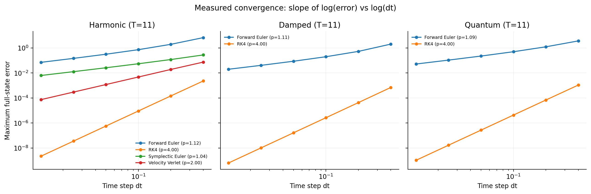
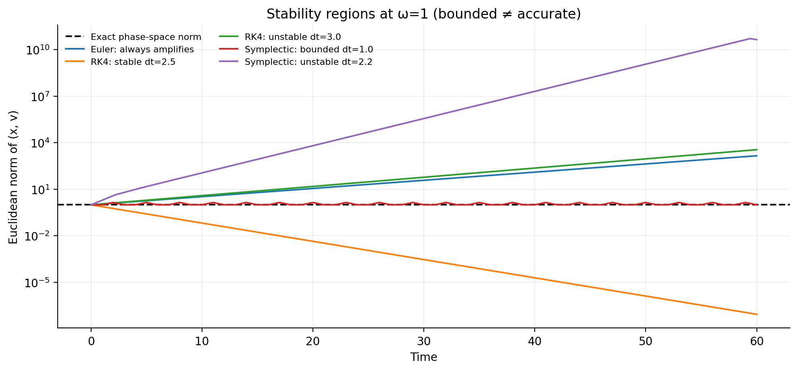
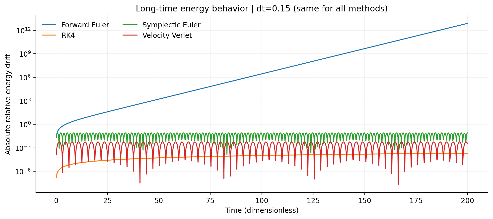
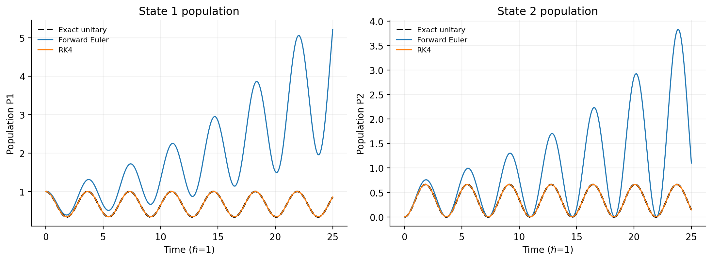

# Numerical Stability & Error Analysis in Dynamical Systems

**Independent computational physics project** | Python · NumPy · SciPy · Matplotlib · pytest

How does the choice of time step and numerical integration method affect the accuracy and physical reliability of a simulated trajectory?

This project compares **Forward Euler, fourth-order Runge–Kutta (RK4), symplectic Euler, and velocity Verlet** using harmonic oscillators, a damped oscillator, and a simple two-state quantum model. It measures convergence against reference solutions and checks for artificial energy or probability drift. An optional avoided-crossing example connects the numerical ideas to nonadiabatic dynamics without claiming to simulate molecular surface hopping.

## Results at a glance

| Convergence by time-step size | Stability regions |
|:--:|:--:|
|  |  |

| Long-time oscillator energy | Two-state quantum populations |
|:--:|:--:|
|  |  |

**Main observation:** Forward Euler spuriously increases energy in an undamped oscillator. RK4 is substantially more accurate at sufficiently small steps but does not exactly conserve energy. Stable symplectic methods tend to show bounded, oscillatory energy errors over long fixed-step integrations. Small energy error alone does not guarantee accurate phase or position.

### Measured convergence order

The included convergence experiment estimates order from the slope of log(error) versus log(time-step size) over a fixed physical interval.

| Model | Method | Observed order | Theoretical order |
|---|---|---:|---:|
| Harmonic oscillator | Euler | 1.118 | 1 |
| Harmonic oscillator | RK4 | 4.000 | 4 |
| Harmonic oscillator | Symplectic Euler | 1.037 | 1 |
| Harmonic oscillator | Velocity Verlet | 2.001 | 2 |
| Damped oscillator | Euler / RK4 | 1.105 / 4.004 | 1 / 4 |
| Two-state quantum system | Euler / RK4 | 1.086 / 4.000 | 1 / 4 |

These are values reported by the included generated data; results may vary slightly with configuration or floating-point environment. The complete methodology, equations, stability bounds, numerical error tables, and limitations appear in the **[technical notes](docs/technical-notes.md)**.

## Reproduce the experiments

Requires **Python 3.11+**.

```bash
git clone https://github.com/Annyax0/Numerical-stability-dynamical-systems.git
cd Numerical-stability-dynamical-systems
python -m venv .venv
source .venv/bin/activate  # Windows: .venv\Scripts\activate
python -m pip install -e '.[dev]'
python -m pytest -q
python -m numerical_dynamics.cli --experiment all
```

Generated figures and tables are written under `outputs/figures/` and `outputs/data/`. Example outputs are committed for review without running the code. An optional exploration notebook is at [notebooks/numerical_methods_exploration.ipynb](notebooks/numerical_methods_exploration.ipynb).

Run a smaller experiment with `python -m numerical_dynamics.cli --experiment harmonic --dt 0.05`, or use `--experiment quantum`, `damped`, `crossing`, or `convergence`. Use `--help` for additional options.

## What I investigated

- **Accuracy and convergence:** Compared custom integrators with exact harmonic, damped, and constant-H quantum reference solutions; used a high-accuracy SciPy numerical reference for the time-dependent crossing.
- **Physical checks:** Examined long-time energy drift in conservative systems, physical energy loss under damping, and population normalization in quantum dynamics.
- **Stability:** Analyzed update-matrix eigenvalues and amplification factors, not just the appearance of trajectory plots.
- **Reproducibility:** Included automated tests, numerical-output exports, and a GitHub Actions test workflow for Python 3.11–3.13.

The source implementation lives in [src/numerical_dynamics/](src/numerical_dynamics/), and automated checks live in [tests/](tests/).

## Scope and next steps

These are deliberately small educational models; the project does **not** implement FSSH, stochastic hops, nuclear trajectories, or realistic molecular electronic-structure calculations. The purpose is to establish a trustworthy baseline for numerical convergence and physical consistency before studying more complex nonadiabatic dynamics.

Future extensions could include a nonlinear pendulum, adaptive time steps, and a norm-preserving two-state propagator. See the [technical notes](docs/technical-notes.md) for derivations, detailed metrics, and scientific limitations.

MIT License.
