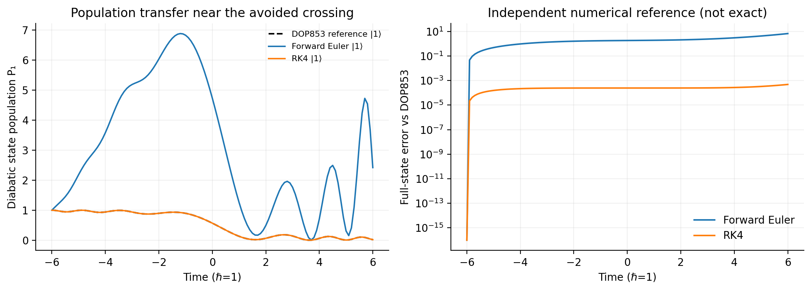

# Technical Notes: Numerical Stability and Error Analysis

This document contains the mathematical definitions, reference systems, convergence diagnostics, measured numerical examples, and limitations underlying the [project overview](../README.md). These experiments are educational computational physics models, not an implementation of fewest-switches surface hopping.

## Numerical methods: what is actually computed?

Given the first-order system **y′ = f(t,y)**, a step of length *h* from (t_n, y_n) is:

**Forward Euler** (one function evaluation per step):

$$
y_{n+1}=y_n+h f(t_n,y_n).
$$

This follows by retaining the linear term in the Taylor expansion $y(t+h)=y(t)+h y'(t)+O(h^2)$. Its local truncation error is $O(h^2)$, producing typically **first-order global error** $O(h)$ over a fixed time horizon.

**Classical Runge–Kutta 4** (four function evaluations per step):

$$
\begin{aligned}
k_1&=f(t_n,y_n),\\
k_2&=f(t_n+h/2,y_n+hk_1/2),\\
k_3&=f(t_n+h/2,y_n+hk_2/2),\\
k_4&=f(t_n+h,y_n+hk_3),\\
y_{n+1}&=y_n+\frac h6(k_1+2k_2+2k_3+k_4).
\end{aligned}
$$

Weighted samples of the vector field cancel lower-order truncation errors; the method has local $O(h^5)$ and **global $O(h^4)$** error under the usual smoothness assumptions. RK4 is explicit and is *not* symplectic or exactly norm-preserving.

**Kick–drift symplectic Euler** is defined for a separable canonical Hamiltonian

$$
H(q,p,t)=\sum_i\frac{p_i^2}{2m_i}+U(q,t),\qquad F(q,t)=-\nabla_q U(q,t).
$$

Its ordered updates are

$$
p_{n+1}=p_n+hF(t_n,q_n),\qquad
q_{n+1}=q_n+h\,p_{n+1}/m.
$$

It is symplectic for this Hamiltonian class at a fixed step size, but it does **not** conserve the exact physical energy at every step. Its trajectory accuracy is first-order. Symplecticity helps constrain long-time qualitative behavior in suitable stable regimes.

**Velocity Verlet** (optional comparison) uses a two-stage force evaluation:

$$
q_{n+1}=q_n+h\frac{p_n}{m}+\frac{h^2}{2m}F(t_n,q_n),\quad
p_{n+1}=p_n+\frac h2[F(t_n,q_n)+F(t_{n+1},q_{n+1})].
$$

For autonomous separable Hamiltonians it is a second-order symplectic method. It is *not* used for the damped equation, where velocity-dependent friction violates the stated separability assumption.

Implementation: [`src/numerical_dynamics/integrators.py`](../src/numerical_dynamics/integrators.py). Every integrator checks time and state inputs, uses `float64`/`complex128` state arrays, returns the full time grid plus solver function-evaluation count, and throws an error for nonfinite states or derivatives. The geometric methods use canonical **momentum** $p=mv$, converted to **velocity** only for plots and comparisons.

## Physical systems and their reference solutions

### A. Undamped harmonic oscillator

$$
m\ddot x+kx=0,\quad \dot x=v,\quad \dot v=-\frac{k}{m}x,\quad
\omega=\sqrt{k/m}.
$$

For the illustrative parameters $m=k=1,\ x(0)=1,\ v(0)=0$, the exact reference is $x(t)=\cos t$, $v(t)=-\sin t$. More generally,

$$
x(t)=x_0\cos(\omega t)+\frac{v_0}{\omega}\sin(\omega t),\quad
v(t)=-\omega x_0\sin(\omega t)+v_0\cos(\omega t).
$$

The mechanical energy $E=\tfrac12mv^2+\tfrac12kx^2$ is exactly constant in continuous time. We plot numerical $x(t)$, Euclidean state error $\|y_n-y(t_n)\|_2$, $E(t)$, phase-space paths $(x,v)$, and long-time relative energy drift. In particular, the long-time comparison runs through **T=200** at the same **dt=0.15** for every integrator.

### B. Damped oscillator

$$
m\ddot x+b\dot x+kx=0,
\qquad \gamma=\frac b{2m},\quad \omega_d=\sqrt{k/m-\gamma^2}.
$$

For $b^2<4mk$, the underdamped solution is

$$
x(t)=e^{-\gamma t}\left[x_0\cos(\omega_d t)+
\frac{v_0+\gamma x_0}{\omega_d}\sin(\omega_d t)\right],
$$

and the analytical velocity is obtained by differentiation. Here $m=k=1,b=0.25$. **Energy decreases physically:** $\mathrm{d}E/\mathrm{d}t=-bv^2\le0$. Decreasing energy therefore is *not* evidence of a flawed integrator. Instead, Euler and RK4 are compared against both the analytical state and the physical energy decay. The automated tests also verify the $b=0$ limit.

### C. Constant two-state quantum dynamics

$$
H=\begin{pmatrix}\Delta/2 & V\\ V & -\Delta/2\end{pmatrix},\qquad
\mathrm i\frac{\mathrm d\psi}{\mathrm dt}=H\psi,\quad \hbar=1.
$$

We use $\Delta=1,\ V=0.7,\ \psi(0)=(1,0)^T$. The populations are $P_i=|\psi_i|^2$, with total probability $P_1+P_2=1$ for exact Hermitian evolution. Since $H$ is constant and Hermitian, the exact reference is

$$
\psi(t)=Q\mathrm{diag}(e^{-\mathrm iE_1t},e^{-\mathrm iE_2t})Q^\dagger\psi(0),
$$

where $H=Q\mathrm{diag}(E_1,E_2)Q^\dagger$. The spectral formula is independently checked against `scipy.linalg.expm` in tests. Euler and RK4 are applied to the **complex-valued** Schrödinger equation, and norm drift is explicitly measured. This is a transparent two-level coherent population-transfer model, **not** a fewest-switches surface-hopping (FSSH) simulation.

### D. Optional avoided-crossing extension

$$
H(t)=\begin{pmatrix}at & V\\V & -at\end{pmatrix},\qquad a=0.5,\ V=0.7.
$$

This reproduces a minimal avoided-crossing Hamiltonian: its instantaneous eigenenergies are $\pm\sqrt{(at)^2+V^2}$, separated by a minimum gap $2|V|$. We propagate from $t=-6$ to $6$ and compare the custom Euler/RK4 solutions against an **independent high-accuracy SciPy DOP853 result** (`rtol=1e-11`, `atol=1e-13`). Unlike the constant-H experiment, this is a **numerical reference**, not an exact analytical solution. No nuclear coordinates, forces on multiple surfaces, stochastic hops, or FSSH trajectories are simulated.

## Quantitative convergence and diagnostics

For each method and $h\in\{0.4,0.2,0.1,0.05,0.025,0.0125\}$, use a **common T=11**. On the computed time grid, define the full-state error $e_n=\|y_n-y_{\mathrm ref}(t_n)\|_2$. We report:

- Final-time error $e_N$, maximum error $\max_n e_n$, and RMS error $\sqrt{N^{-1}_{\rm samples}\sum_n e_n^2}$.
- Maximum **relative** energy error $\max_n |E_n-E_0|/|E_0|$ for the undamped oscillator, or maximum **absolute** probability norm error $\max_n|P_1+P_2-1|$ for the quantum model. The dissipative oscillator has no conserved mechanical energy, so its corresponding CSV field is blank.
- Time steps, function evaluations, and the **median of three solver-only wall-clock runs**; all timing claims depend on hardware/load/Python version.

The observed order $p$ is the least-squares slope in

$$
\log(\max_n e_n)=p\log(h)+C.
$$

Fit the **four smallest steps** (`0.1`, `0.05`, `0.025`, `0.0125`), omitting any values with error $\le 10^{-13}$ to avoid attempting to fit numerical noise. The slope and $R^2$, including the chosen steps, are exported to `outputs/data/convergence_slopes.csv`. A finite-range fit can deviate from the ideal asymptotic power law, particularly for Euler.

### Observed orders from the included completed run

| Experiment | Method | Measured p | Expected p |
|---|---|---:|---:|
| Harmonic | Euler | **1.118** | 1 |
| Harmonic | RK4 | **4.000** | 4 |
| Harmonic | Symplectic Euler | **1.037** | 1 |
| Harmonic | Velocity Verlet | **2.001** | 2 |
| Damped | Euler | **1.105** | 1 |
| Damped | RK4 | **4.004** | 4 |
| Constant two-state | Euler | **1.086** | 1 |
| Constant two-state | RK4 | **4.000** | 4 |

To illustrate the difference at **dt=0.1**, in the separately plotted single-run experiments:

| Model (time horizon) | Method | Max full-state error | Max physical-invariant error |
|---|---|---:|---:|
| Harmonic (T=30) | Euler | 3.455 | 18.79 relative energy drift |
| Harmonic (T=30) | RK4 | 2.50×10⁻⁵ | 4.16×10⁻⁶ relative energy drift |
| Harmonic (T=30) | Symplectic Euler | 0.0625 | 0.0526 relative energy drift |
| Harmonic (T=30) | Verlet | 0.0128 | 0.00250 relative energy drift |
| Damped (T=30) | Euler | 0.199 | not applicable; physically dissipative |
| Damped (T=30) | RK4 | 2.65×10⁻⁶ | not applicable; physically dissipative |
| Two-state (T=25) | Euler | 1.516 | 5.317 absolute probability drift |
| Two-state (T=25) | RK4 | 9.81×10⁻⁶ | 1.41×10⁻⁶ absolute probability drift |

All numbers above were read from actual CSV outputs generated by the code, not inserted as expected values. The test environment used **Python 3.13.5**. Timing values themselves are in the CSV rather than held out as portable speed claims.

## A separate linear stability calculation

For the undamped oscillator, the first-order system matrix is

$$
A=\begin{pmatrix}0&1\\-\omega^2&0\end{pmatrix},\qquad
\lambda_\pm=\pm \mathrm i\omega.
$$

Euler has update matrix $I+hA$, so each eigenmode is multiplied by $g_E(z)=1+z$, $z=h\lambda$. On the imaginary axis,

$$
|g_E(\mathrm i\omega h)|=\sqrt{1+(\omega h)^2}>1
$$

for every nonzero h. Thus **Forward Euler is unstable over arbitrarily long integrations of the undamped oscillator**, even if a short run may appear acceptable.

RK4 has stability polynomial $R(z)=1+z+z^2/2+z^3/6+z^4/24$. On the imaginary axis, $|R(\mathrm i\omega h)|\le1$ when $0\le\omega h\le\sqrt8$; outside this range the oscillator mode grows. **Being inside this region controls growth, not phase accuracy**: RK4 can damp a constant-amplitude oscillation significantly at a large but 'stable' time step.

For the unit-mass kick–drift scheme, the update matrix is

$$
M=\begin{pmatrix}1-(\omega h)^2&h\\-\omega^2 h&1\end{pmatrix},\qquad
\det M=1,\quad\mathrm{tr}\,M=2-(\omega h)^2.
$$

Its eigenvalues lie on the unit circle and its powers are bounded when **0 < ωh < 2** (strict inequality). At the boundary, a Jordan block can give linear growth. Beyond the boundary, a real eigenvalue has modulus greater than 1, causing instability. `outputs/figures/stability_regimes.png` shows both sides of these bounds. This is an eigenvalue/amplification argument, not merely a plot-based guess.

### Terms worth keeping distinct

| Concept | Meaning |
|---|---|
| Local truncation error | Defect created by **one step** starting from an exact state; typically $O(h^{p+1})$ for order p |
| Global discretization error | Accumulated state error over a **fixed physical interval**; typically $O(h^p)$ for a stable, consistent p-th order method |
| Numerical stability | Whether perturbations or modes are damped, preserved, or spuriously amplified by the discrete update |
| Conservation | Whether an exact physical invariant (energy/norm) is reproduced by a discretization |
| Floating-point error | Rounding caused by finite-precision machine arithmetic, which can overwhelm truncation error at extremely small steps |

## Scientific and engineering limitations

- Oscillators are linear, and the quantum examples have only two coupled states. Nonlinear/chaotic dynamics, stochastic methods, adaptive time steps, FSSH hops, and real experimental data are out of scope.
- The exact constant-H reference uses Hermitian diagonalization (checked against SciPy `expm`); the time-dependent crossing uses **numerically** tight DOP853 tolerances, not a closed-form solution.
- Differences at sufficiently small h can encounter floating-point roundoff; a convergence fit must exclude zero/roundoff-dominated points. Reported error is computed **on each method's own output grid**, not a continuous-time supremum.
- Timing medians are observations on the executing machine; they should not be generalized as relative compiler-optimized performance.
- Fixed-step stability results assume the stated linear oscillator. Geometric integrators assume separable canonical Hamiltonians and do not apply directly to friction or generic velocity-dependent forces.
- The last step is shortened to honor the requested end time. Such a final-step adjustment preserves the local method formula, but the usual fixed-step symplectic analysis is strictly about repeated constant-sized steps.
